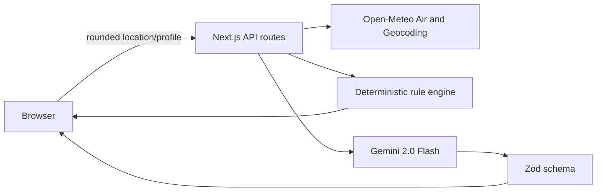

# BreatheEasy

BreatheEasy is a production-ready urban air quality assistant that helps families and communities navigate severe winter smog with low-emission routines, indoor filtration, location-tailored planning, and transparent impact estimates.

## Problem Statement Coverage

| Requirement | Feature | Implementation |
|---|---|---|
| GenAI-powered assistant | Gemini chat and Plan my day | Server-only Gemini integration with JSON validation and 8-second fallback |
| Families and communities | Household profile and pledge | 4-step local profile and neighborhood/share card |
| Low-emission routines | Smog-smart planner | Hour timeline and commute alternatives |
| Indoor air quality hacks | Indoor toolkit | Purifier, ventilation, sealing, mask, cooking, and sweeping guidance |
| Sustainable alternatives | Alternatives panel | Metro, induction, shared trips, no-burning actions |
| Location + lifestyle tailoring | City/geolocation + profile | Rounded coordinates, commute, home, cooking, budget, and vulnerability profile |
| Clear impact explanation | Impact explainer | CO2/NOx, purifier, and PM2.5 equivalents with assumptions |

## Architecture



## Features

- Live AQI hero with US AQI, PM2.5, PM10, NO2, O3, and family guidance.
- Demo mode using Delhi-style AQI 380.
- 24-hour color timeline and clean-window guidance.
- Gemini assistance with timeout and deterministic fallback.
- Local-only household profile and streak.
- Community pledge and native/copy sharing.
- English and Hindi.
- PWA shell cache and offline banner.

## Impact assumptions

- Petrol car: 170 g CO2/km.
- Metro: 28 g CO2/km.
- Petrol NOx: 0.55 g/km; metro NOx: 0.04 g/km.
- Cigarette equivalent: 22 µg/m³ PM2.5 over 24 hours is approximately one cigarette.
- Purifier estimate: CADR relative to room area, bounded from 15% to 80%.

These are planning estimates, not clinical or lifecycle measurements. Severe symptoms require professional medical care.

## Security

- Gemini key stays server-side.
- Coordinates are rounded to two decimals.
- Zod validates API bodies.
- AI input is capped and delimited; output is schema validated.
- In-memory IP rate limiting allows 10 requests/minute.
- CSP, HSTS, frame restrictions, permissions policy, and sanitized errors are enabled.
- No analytics, tracking cookies, or precise-location logging.

## Setup

```bash
cd breatheeasy
npm install
cp .env.example .env.local
npm run dev
```

Visit `http://localhost:3000`. Demo and rule mode work without Gemini credentials.

## Environment

| Variable | Required | Purpose |
|---|---:|---|
| GEMINI_API_KEY | No | Enables enhanced Gemini advice |
| UPSTASH_REDIS_REST_URL | No | Optional distributed rate limiting |
| UPSTASH_REDIS_REST_TOKEN | No | Optional distributed rate limiting |

## Commands

```bash
npm run test
npm run test:e2e
npm run lint
npm run typecheck
npm run check
npm run build
npm start
```

## Deployment

Deploy the `breatheeasy` directory to Vercel. Set `GEMINI_API_KEY` in Vercel project environment settings. Open `/api/health` to verify readiness.

## 60-second judge demo

1. Open AQI 380 demo mode.
2. Click “Plan my family’s day.”
3. Show the timeline and clean outdoor window.
4. Open the indoor toolkit and impact drawer.
5. Switch to Hindi and plan again.
6. Open household profile and change commute.
7. Share the community pledge.

## Known limitations

- Open-Meteo depends on network access.
- Exposure equivalents are approximations, not clinical measurements.
- Impact factors are planning estimates.
- Demo mode is clearly labeled and not live evidence.
