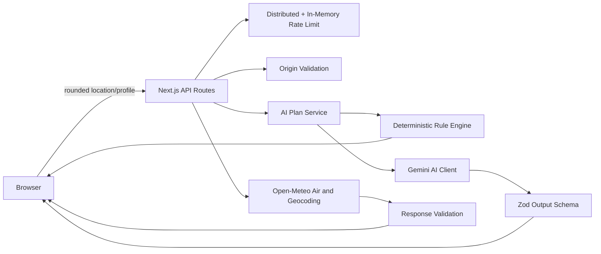

# BreatheEasy

BreatheEasy is a production-ready urban air quality assistant that helps families and communities navigate severe winter smog with low-emission routines, indoor filtration, location-tailored planning, and transparent impact estimates.

## Problem Statement Coverage

| Requirement | Feature | Implementation |
|---|---|---|
| GenAI-powered assistant | Gemini chat and Plan my day | Server-only Gemini integration with JSON validation and deterministic fallback |
| Families and communities | Household profile and pledge | 4-step local profile and neighborhood/share card |
| Low-emission routines | Smog-smart planner | Hour timeline and commute alternatives |
| Indoor air quality hacks | Indoor toolkit | Purifier, ventilation, sealing, mask, cooking, and sweeping guidance |
| Sustainable alternatives | Alternatives panel | Metro, induction, shared trips, no-burning actions |
| Location + lifestyle tailoring | City/geolocation + profile | Rounded coordinates, commute, home, cooking, budget, and vulnerability profile |
| Clear impact explanation | Impact explainer | CO2/NOx, purifier, and PM2.5 equivalents with assumptions |

## Architecture



### Layer separation

- **API routes** (`src/app/api/*`): HTTP handling, CSRF, rate limiting, request validation, response formatting. No business logic.
- **Plan service** (`src/lib/ai/plan-service.ts`): Orchestrates Gemini AI calls with deterministic fallback. Server-only.
- **Rule engine** (`src/lib/rules/engine.ts`): Pure deterministic advice generation from AQI + household profile.
- **AI client** (`src/lib/ai/client.ts`): Gemini API communication with retry, timeout, and error classification.
- **Output validation** (`src/lib/ai/output-validation.ts`, `gemini-validation.ts`, `air-validation.ts`, `city-validation.ts`, `advice-validation.ts`): Zod schemas for all external/API responses.
- **Security** (`src/lib/security/*`): Rate limiting, input validation, CSRF, environment validation.

## Features

- Live AQI hero with US AQI, PM2.5, PM10, NO2, O3, and family guidance.
- Demo mode using Delhi-style AQI 380.
- 24-hour color timeline and clean-window guidance.
- Gemini assistance with retry, timeout, and deterministic fallback.
- Local-only household profile and streak.
- Community pledge and native/copy sharing.
- English and Hindi.
- PWA shell cache and offline banner.

## Impact assumptions

- Petrol car: 170 g CO2/km.
- Metro: 28 g CO2/km.
- Petrol NOx: 0.55 g/km; metro NOx: 0.04 g/km.
- Cigarette equivalent: 22 µg/m³ PM2.5 over 24 hours is approximately one cigarette.
- Purifier estimate: CADR relative to room area, bounded from 15% to 80%.

These are planning estimates, not clinical or lifecycle measurements. Severe symptoms require professional medical care.

## Security

- Gemini key stays server-side, never exposed to the browser.
- Coordinates are rounded to two decimals before server use.
- Zod validates every API request body and external API response.
- AI input is capped at 1,600 characters and delimited; output is schema validated.
- Distributed rate limiting via Upstash Redis with in-memory fallback (10 requests/minute per IP).
- CSRF origin validation on state-changing methods.
- CSP, HSTS, frame restrictions, permissions policy, and sanitized errors via middleware.
- No analytics, tracking cookies, or precise-location logging.

## CI/CD

GitHub Actions runs on every push and pull request:

1. Formatting check (`prettier --check`)
2. ESLint (`npm run lint`)
3. TypeScript (`npm run typecheck`)
4. Unit tests (`npm run test`)
5. Production build (`npm run build`)
6. Dependency audit (`npm audit --production`)

## Setup

```bash
cd breatheeasy
npm install
cp .env.example .env.local
npm run dev
```

Visit `http://localhost:3001`. Demo and rule mode work without Gemini credentials.
Smart Mode requires a real Gemini API key in `.env.local`; the example key is blank so the app uses the safe baseline plan until you configure one.

## Environment

| Variable | Required | Purpose |
|---|---:|---|
| GEMINI_API_KEY | No | Enables enhanced Gemini advice |
| UPSTASH_REDIS_REST_URL | No | Optional distributed rate limiting |
| UPSTASH_REDIS_REST_TOKEN | No | Optional distributed rate limiting |

## Commands

```bash
npm run test           # Unit tests (vitest)
npm run test:e2e       # End-to-end tests (Playwright)
npm run lint           # ESLint
npm run typecheck      # TypeScript
npm run check          # Lint + typecheck + tests
npm run build          # Production build
npm run start          # Production server on :3001
npm run format         # Prettier format
```

`npm run start` serves the production build on `http://localhost:3001`. Run `npm run build` first, and stop the development server before starting production.

## Deployment

Deploy the `breatheeasy` directory to Vercel. Set `GEMINI_API_KEY` in Vercel project environment settings. Open `/api/health` to verify readiness.

## 60-second judge demo

1. Open AQI 380 demo mode.
2. Click "Plan my family's day."
3. Show the timeline and clean outdoor window.
4. Open the indoor toolkit and impact drawer.
5. Switch to Hindi and plan again.
6. Open household profile and change commute.
7. Share the community pledge.

## Known limitations

- Open-Meteo depends on network access.
- Exposure equivalents are approximations, not clinical measurements.
- Impact factors are planning estimates.
- Demo mode is clearly labeled and not live evidence.
